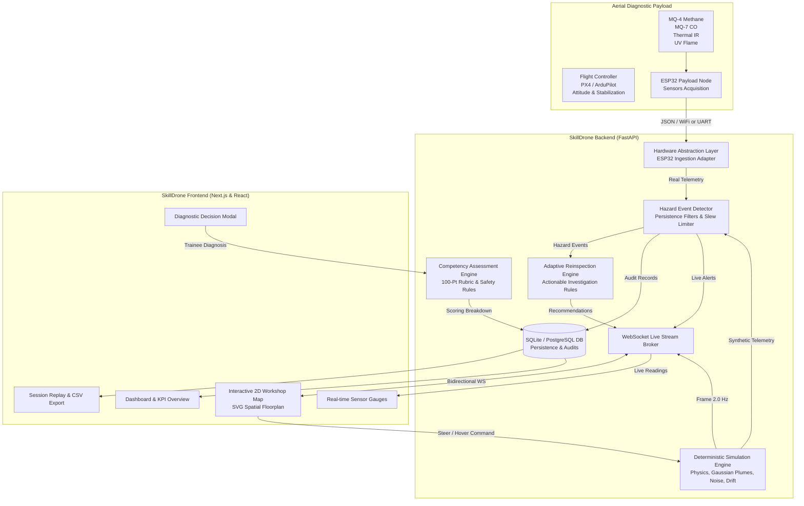
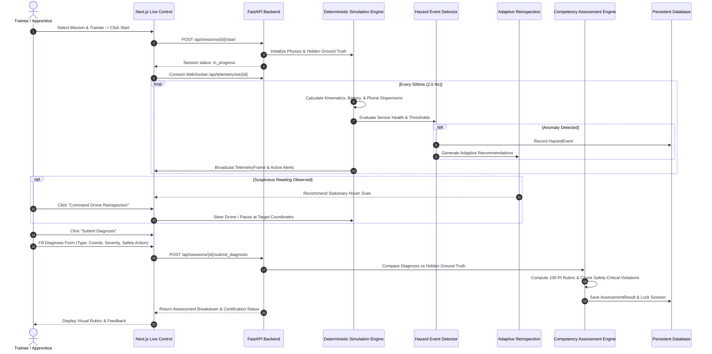

# SkillDrone System Architecture & Data Flow

SkillDrone combines real-time sensor processing, deterministic physics simulation, spatial workshop mapping, adaptive reinspection recommendations, and a transparent 100-point competency assessment engine.

---

## High-Level Architecture Diagram

---

## Mission Lifecycle Sequence Diagram

